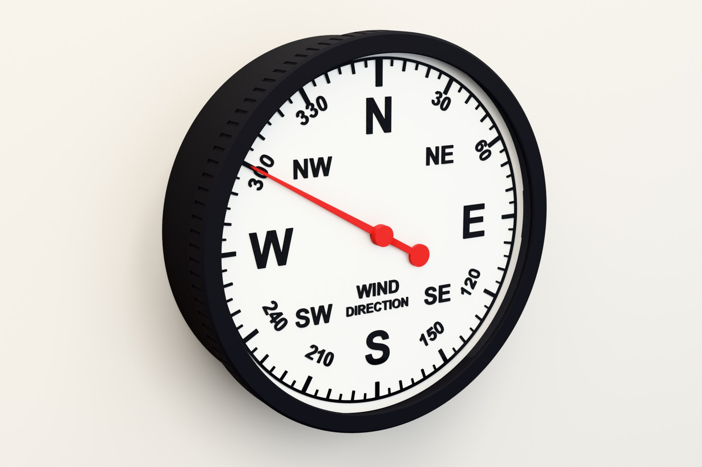
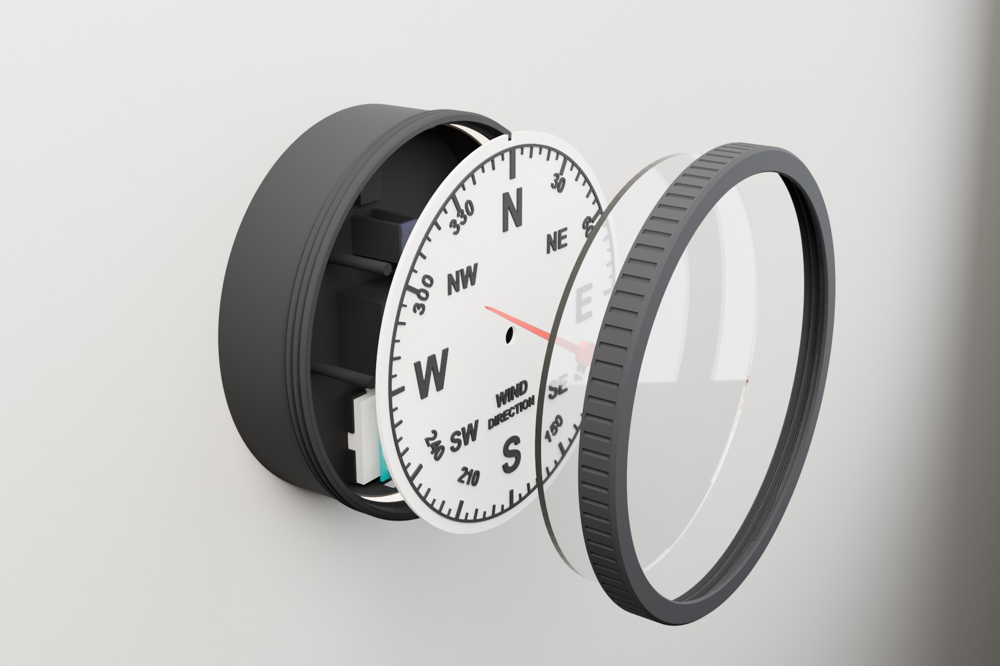
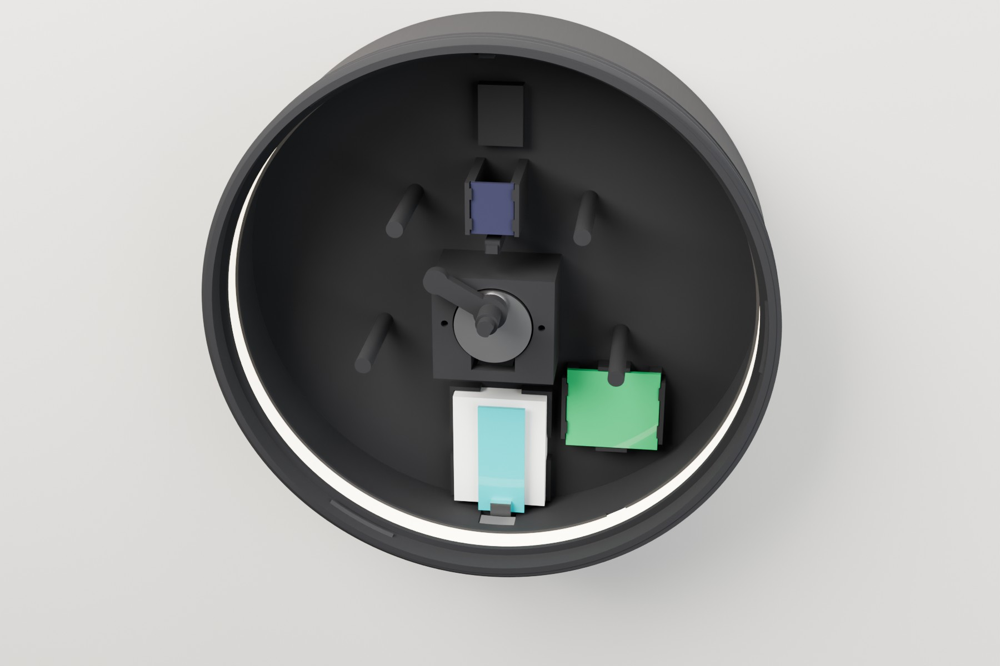
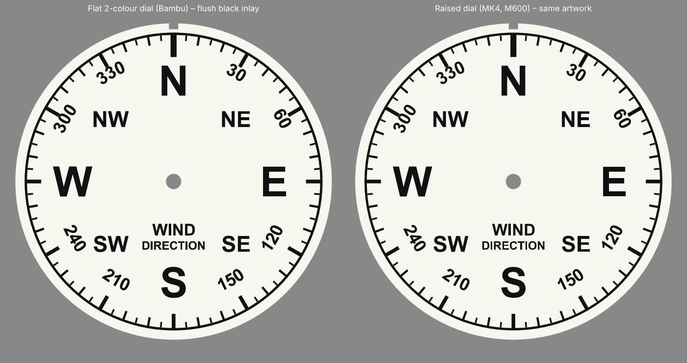
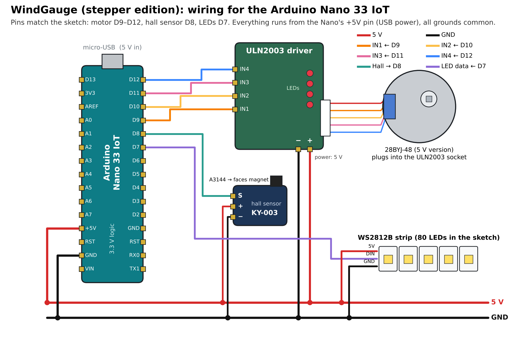

Open Gauges started in October 2021 as part of the Sensor Data Visualisation module (CASA0019) in the MSc in Connected Environments at CASA, UCL. The idea, which Valerio Signorelli and I set out in the <a href="/blog/2022/06/14/open-gauges-physical-data-display-devices/">original post</a>, was simple: open-source data gauges that anyone can print, wire up and point at a live data feed, whether that is wind speed, air pressure, air quality or energy. The <a href="https://github.com/ucl-casa-ce/Open-Gauges" target="_blank" rel="noopener">Open Gauges GitHub</a> holds the code, the print files and the dial graphics, and it has grown since then to include a <a href="/blog/2022/05/31/owmbarometer/">NeoPixel barometer</a>, a voltmeter gauge, the <a href="/blog/2023/11/09/lightsaber/">lightsaber wind speed tube</a>, a <a href="/blog/2025/11/12/ships-lamp-wind-speed-gauge/">ship's lamp</a> and a <a href="/blog/2025/11/13/stepper-motor-linear-data-gauge/">one-metre linear stepper gauge</a>.

The latest addition is a wind direction dial, its the first one made with input from Claude via Fusion (via our own human made tutorial on how to make data guages) and it changes how the dial-based gauges move.

<figure class="wp-block-image size-large">
<figcaption>The new wind direction gauge: 205 mm across, with a screw-on bezel and an acrylic window.</figcaption></figure>

<h2>From Servos to Steppers</h2>

The original gauges used a standard SG90 servo with the ServoEasing library. Servos are cheap and easy, but they have limits. Most only turn about 180 degrees, so the 270 and 360 degree dials needed a printed gear train to stretch the range. Their resolution is coarse, and they tend to jitter around the target as they hold position. For wind direction there is a bigger problem: a servo cannot wrap round. If the wind moves from 350 degrees to 10, the needle has to travel back across almost the whole dial to get there.

The new gauge uses a 28BYJ-48 stepper motor with a ULN2003 driver, the same pairing as the linear gauge. Through its internal gearbox and run in half-steps, the motor makes roughly 4,096 steps per revolution, which is about eleven steps per degree. In practice that means the pointer can sit within a tenth of a degree of where it should be, with no jitter and no gear train. It also turns continuously, so the code always takes the shortest route: 350 to 10 degrees is a 20 degree move clockwise, exactly as a weather vane would swing.

<h2>Finding North</h2>

A stepper only knows how far it has moved, not where it is, so it needs a fixed reference. A small printed carrier sits on the motor shaft between the motor and the dial. It holds a 5 mm magnet, and the pointer slots onto the top of the same carrier. On start-up the motor turns until the magnet passes a KY-003 hall sensor at North.

The sketch then makes one full turn from magnet to magnet to measure the motor's real steps per revolution. That matters more than it sounds: the 28BYJ-48's gearbox is not exactly 64:1, so assuming a round number slowly builds up error. Measuring it means any motor calibrates itself. A single offset in the code fine-tunes North against the N on the dial, and the gauge re-homes on the magnet every six hours to clear any drift.

<figure class="wp-block-image size-large">
<figcaption>Exploded view: case with the motor, driver and electronics, the magnet carrier, dial, pointer, acrylic window and screw-on bezel.</figcaption></figure>

<h2>A Smoother Tween</h2>

The movement is handled by the AccelStepper library, with acceleration and a maximum speed set in the sketch. Rather than snapping to a new reading, the pointer eases out, travels and eases in again, much like the needle on a real instrument. A small shift of ten degrees takes a couple of seconds; a full half-turn takes around ten. As the data updates, the dial drifts and swings with the wind rather than jumping from value to value, which is exactly the quality that made the linear gauge one of the most watched objects in our lounge.

The data comes from our own weather station over MQTT, the same feed behind the <a href="/blog/2026/08/04/fenland-a-weewx-dashboard-that-scores-its-own-forecasts-ensemble-spread-climate-records-back-to-1940-nightly-forecast-verificationand-finally-that-tween/">Fenland dashboard</a>, but the gauge will follow any topic that publishes a bearing in degrees.

<h2>Inside the Case</h2>

Everything inside has its own printed seat and clips in. The motor drops into a central block, the driver snaps into a cradle beside it, and an Arduino Nano 33 IoT sits on a mini breadboard in a tray at the bottom, with its USB port lined up with an opening in the case wall. A WS2812B LED strip clips into a channel round the inside of the case, just under the dial, so it lights the dial from behind without any wires casting shadows.

<figure class="wp-block-image size-large">
<figcaption>Dial removed: the 28BYJ-48 in the centre, the hall sensor above it, the ULN2003 to the right and the Nano 33 IoT on its breadboard at the bottom.</figcaption></figure>

The bezel screws onto the case on a 200 mm printed thread and holds a 190 mm, 3 mm acrylic window. The whole gauge hangs on a single screw through a centred keyhole. All five parts print without supports, and the largest, the bezel, is just under 205 mm, so it fits a Prusa MK4 or a Bambu X1, P1 or A1.

<h2>Two Dials</h2>

There are two versions of the dial with the same artwork. The first has raised black marks, printed in white with a single filament change. The second is flat, with the black marks inlaid flush and printed face down, which gives a perfectly smooth face. It prints easily on a multi-colour printer, and on a single-extruder Prusa MK4 with three or four manual filament swaps.

<figure class="wp-block-image size-large">
<figcaption>Flat two-colour inlay (left) and raised marks (right).</figcaption></figure>

<h2>Build Your Own</h2>

The wiring is deliberately simple: four pins to the driver, one to the hall sensor and one to the LEDs, all powered from the Nano's USB.

<figure class="wp-block-image size-large">
<figcaption>Wiring for the Nano 33 IoT: D9 to D12 to the driver, D8 to the hall sensor and D7 to the LEDs.</figcaption></figure>

The print files, the full Fusion 360 model, the Arduino sketch and an illustrated how-to guide are all on the <a href="https://github.com/ucl-casa-ce/Open-Gauges" target="_blank" rel="noopener">Open Gauges GitHub</a>. As with the rest of the project, the files are open to build on, so new dials, new data feeds and new gauges are always welcome.

