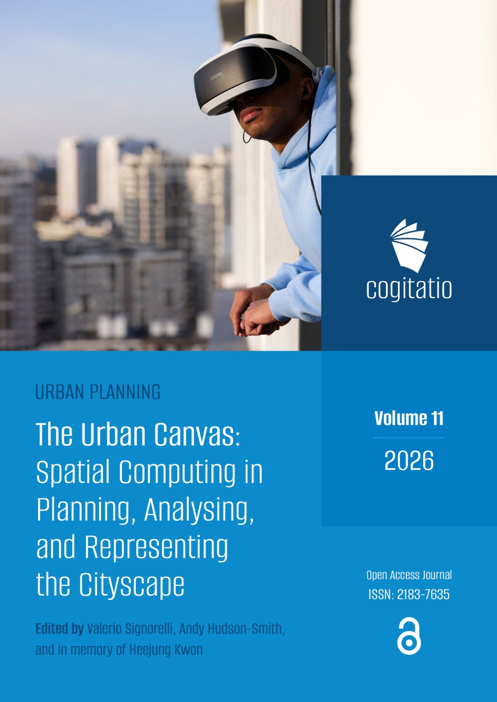

With the editorial published today, our special issue of <a href="https://www.cogitatiopress.com/urbanplanning" target="_blank" rel="noopener">Urban Planning</a> (Cogitatio Press) is now complete. <a href="https://doi.org/10.17645/up.i484" target="_blank" rel="noopener"><em>The Urban Canvas: Spatial Computing in Planning, Analysing, and Representing the Cityscape</em></a> was edited with Valerio Signorelli, and is dedicated to the memory of Heejung Kwon of Yonsei University. Every article is open access and free to download.

<figure class="wp-block-image size-large">
<figcaption><em>Urban Planning</em>, Vol 11 (2026), thematic issue <em>The Urban Canvas</em>.</figcaption></figure>

<h2>From Representation to Experience</h2>

Planning has always been a visual discipline. Maps, plans, sections, models and renders are how change gets communicated. What they are less good at is letting people actually experience a proposed place before it exists. You arguably, still need to read a plan to understand a proposed new space.

The issue starts from the idea that spatial computing changes that relationship. Augmented, virtual and mixed reality, digital twins, photogrammetry, situated visualisation and location-based audio all, in different ways, treat space not just as something to analyse but as an interactive medium in its own right. The collection is less about the technology itself and more about what happens as the digital and physical merge, how that changes the way urban space is experienced and produced, and how it reshapes the relationships between planners, citizens, data and place.

Running through all eight papers are the same three questions, access, governance and representation. Who gets to see the layer, who controls it, and whose city it shows. Arguably, the importance of spatial computing for planning lies as much in the questions it forces as in the tools it offers.

<h2>The Papers</h2>

<strong><a href="https://www.cogitatiopress.com/urbanplanning/article/view/12412" target="_blank" rel="noopener">Spatial Computing and the Phygital City: Towards Digital Habitation</a></strong> (Hudson-Smith). Our own contribution, which I <a href="/blog/2026/09/09/spatial-computing-and-the-phygital-city-towards-digital-habitation/">wrote about in September</a>. Our own paper sets out a three-stage model, Smart City to Phygital City to digital habitation, and argues that the middle stage, where physical and digital are experienced together in the street, is a distinct planning condition that needs its own vocabulary and its own anticipatory governance.

<strong><a href="https://www.cogitatiopress.com/urbanplanning/article/view/12420" target="_blank" rel="noopener">City as Canvas: Situating Digital Layers Across Urban Spaces</a></strong> (Signorelli). With the metaverse hype fading, Valerio makes the case for rethinking it as digital layers on everyday urban space rather than a separate virtual world. Social media, sensor networks and institutional datasets usually sit apart from the places that produce them, and the paper proposes situated visualisation as a way of putting that information back in context, tested through co-creation workshops in the Royal Docks and Queen Elizabeth Olympic Park.

<strong><a href="https://www.cogitatiopress.com/urbanplanning/article/view/12297" target="_blank" rel="noopener">Morecambe Area Gaming Environment (MAGE): An Applied Case Study for Coastal Futures and Adaptations</a></strong> (Cureton, Delaney, Xia, Lin, Ilic and Earl). A proof of concept for helping councils and residents talk about long-term, uncertain coastal flood risk in Morecambe. MAGE spans a community mapping platform, tabletop games for schools and for planning, a digital sandbox and a VR experience, built around a decision table that brings together coastal models, GIS and game-engine logic so users can test climate scenarios and choose interventions, from nature-based solutions to hard engineering.

<strong><a href="https://www.cogitatiopress.com/urbanplanning/article/view/12513" target="_blank" rel="noopener">The Virtual Embodied Experience: Virtual Reality as a Medium for Computing, Analysing, and Representing the Cityscape</a></strong> (LLabres-Valls). VR in architecture and urban research is still mostly used for visualisation and simulation. Reviewing the literature, Enriqueta finds embodied approaches poorly connected to data-driven workflows, and proposes the Virtual Embodied Experience framework, treating VR as a cognitive interface for moving through environmental data as a spatial condition, linked to ARB and RIBA expectations on climate literacy and ecological design.

<strong><a href="https://www.cogitatiopress.com/urbanplanning/article/view/12126" target="_blank" rel="noopener">Creating Synthetic Road Networks Using Large Language Models: An Iterative Calibration Framework</a></strong> (Kasiński and Szufel). Where a digital twin models one real city in data-hungry detail, synthetic cities offer families of controlled, repeatable models for testing regulation, climate adaptation and participatory design without sensitive or costly field data. The paper uses an LLM to generate high-level road structures from natural-language requirements, then refines them against target metrics through tool-based feedback.

<strong><a href="https://www.cogitatiopress.com/urbanplanning/article/view/12209" target="_blank" rel="noopener">"Town Built From Fleeting Matter": Audiowalking San'ya's Hidden Histories as Practice-Led Spatial Inquiry</a></strong> (Woite). Spatial computing does not have to be visual. Lisa revisits <em>placeless: San'ya</em>, an audiowalk in a Tokyo district whose name has been officially erased but whose associations with marginalisation remain. First made in 2021 and restaged in 2025 with geolocated audio, keeping the story the same while changing the technology shows how sound triggered by movement can guide attention without pulling people out of their surroundings, along with the ethical questions of mediated presence in unequal places.

<strong><a href="https://www.cogitatiopress.com/urbanplanning/article/view/12322" target="_blank" rel="noopener">Within the Flows: Participatory 3D Scanning in Asian Techno-Industrial Hinterlands</a></strong> (Müller). A comparison of two state-planned high-tech industrial enclaves on the urban edges of Chennai and Hsinchu, linked through global supply chains. Using participatory photogrammetry grounded in walking and sensory methods, workshop outputs captured a shared sense that these transformations feel unstoppable, and have been gathered into a web platform, the Techno-Urban Atlas.

<h2>A Canvas, Not a Surface</h2>

Taken together, the papers move across scales and methods, from a coastal town in Lancashire to industrial enclaves in India and Taiwan, from headsets to tabletop games to sound. What they share is a view of the city as a social, spatial and infrastructural environment rather than a neutral surface to paint data on. The canvas pushes back. That, perhaps, is the point of the title.

Our thanks to all the authors and reviewers, and to the team at Cogitatio. The issue is dedicated to the memory of Heejung Kwon.

<h2>Read It</h2>
<ul>
 	<li><strong><a href="https://www.cogitatiopress.com/urbanplanning/issue/view/484" target="_blank" rel="noopener">The Urban Canvas</a></strong> - full issue</li>
 	<li><strong><a href="https://www.cogitatiopress.com/urbanplanning/article/view/13413" target="_blank" rel="noopener">Editorial</a></strong> - Signorelli and Hudson-Smith, DOI: <a href="https://doi.org/10.17645/up.13413" target="_blank" rel="noopener">10.17645/up.13413</a></li>
 	<li>Issue DOI: <a href="https://doi.org/10.17645/up.i484" target="_blank" rel="noopener">10.17645/up.i484</a></li>
</ul>

<em>Signorelli, V. and Hudson-Smith, A. (2026) The Urban Canvas: Spatial Computing in Planning, Analysing, and Representing the Cityscape. Urban Planning, 11. doi: <a href="https://doi.org/10.17645/up.13413" target="_blank" rel="noopener">10.17645/up.13413</a></em>

