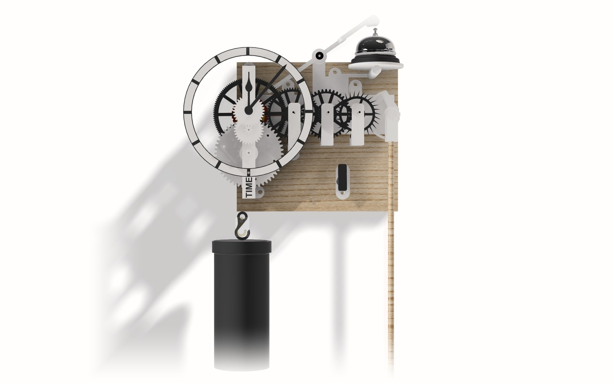
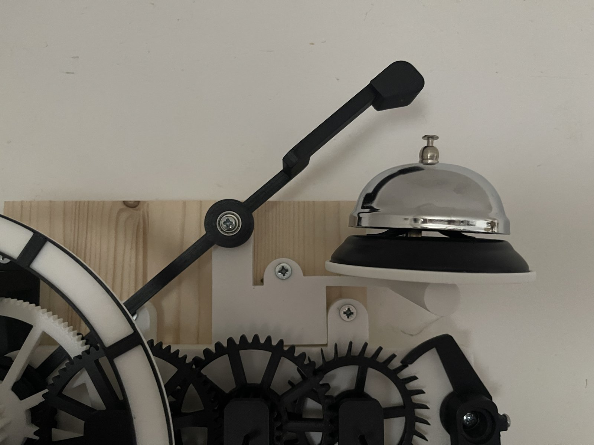
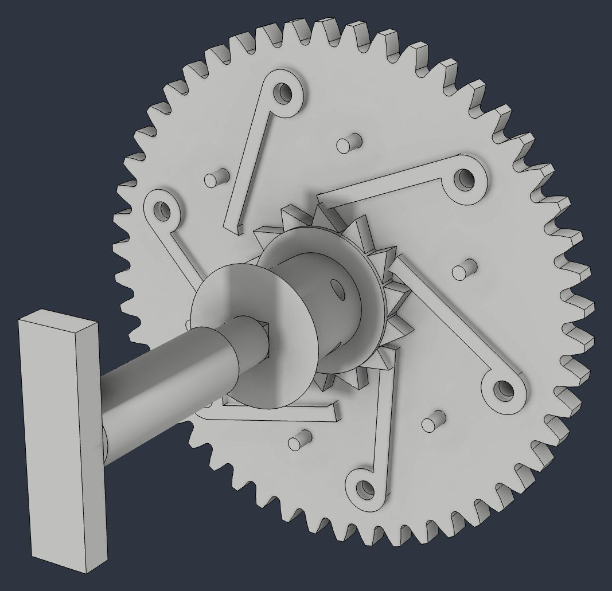
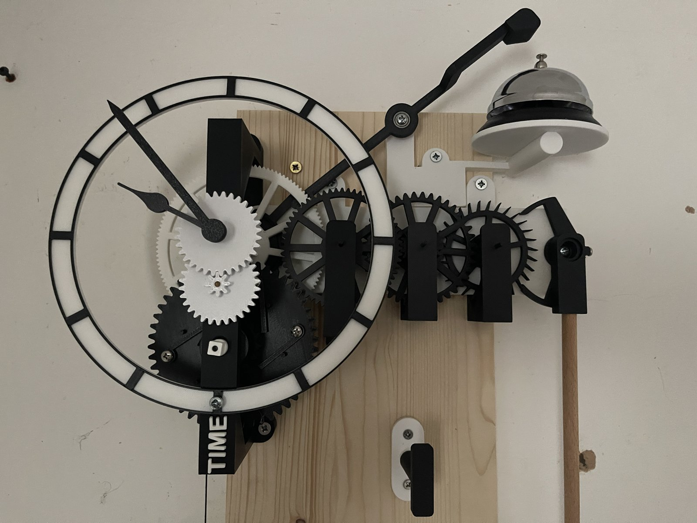
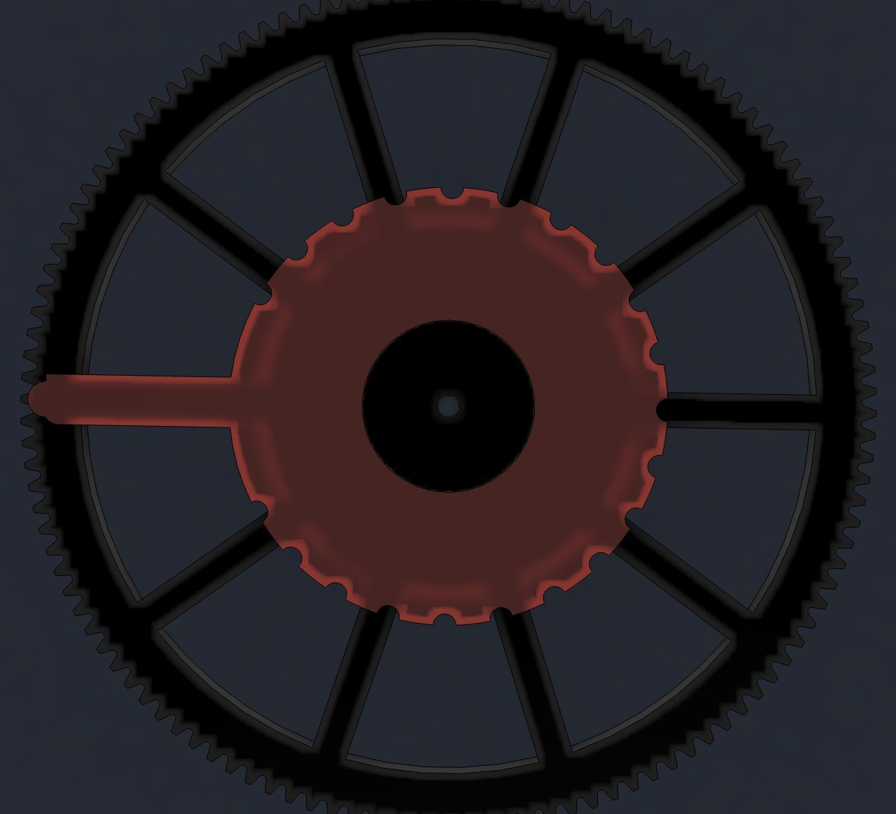
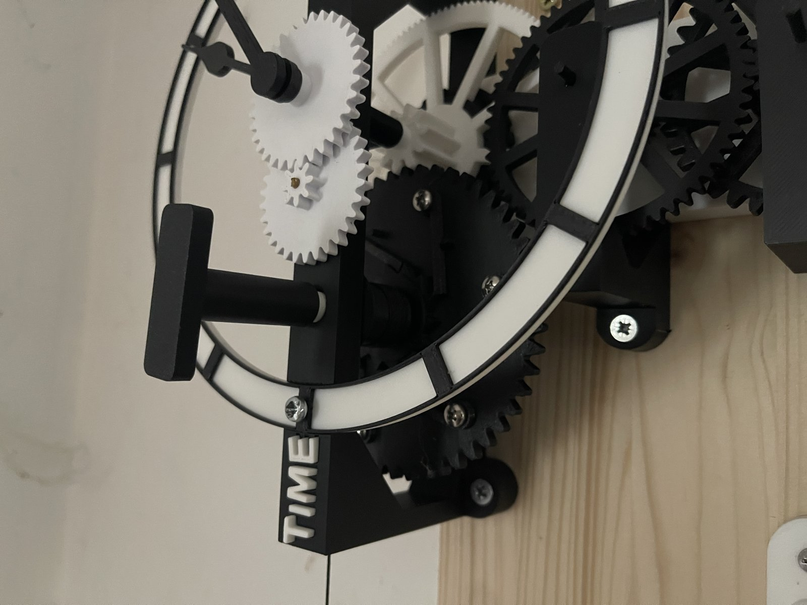
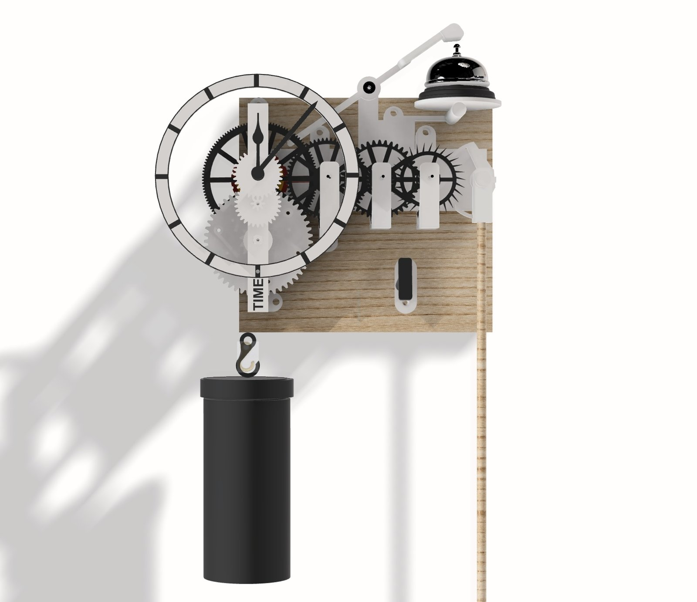

In August 2025 we released <a href="/blog/2025/08/05/time-an-open-source-3d-printed-clock/">TIME</a>, a fully 3D printed, weight-driven pendulum clock built from first principles. It has been ticking on the wall ever since, and living with a clock teaches you things that designing one never does. The one-second tick and easy build was the aim and the clock has been happily running for a year. Winding it, setting it and getting the bell to ring at the right moment were, however, another story.

So TIME has a sequel. <strong>TIME2</strong> keeps the heart of the original but rethinks the winding and the setting of the bell. As before, it is open source, with every part ready to print and a full step-by-step build guide. There is also an upgrade pack, so if you already have a TIME on your wall you only need to print a handful of new parts. Both are on <a href="https://www.printables.com/model/1909422-time2-a-3d-printed-weight-driven-clock-with-key-wi" target="_blank" rel="noopener">Printables</a>.

<figure class="wp-block-image size-large">
<figcaption>TIME2 on the wall: the going train runs along the back plate, with the dial at one end, the bell at the top and the key peg on the board below.</figcaption></figure>

<blockquote>
The aim was not a new clock, but the clock TIME should have been once I had lived with it for a year.
</blockquote>

<h2>What I Wanted to Fix</h2>

<ol>
<li><strong>Winding.</strong> TIME was wound with an offset winder gear and a four-part key. I wanted a proper key on a winding square, through the dial, like a real clock.</li>
<li><strong>Setting the time.</strong> The hands should turn by hand while the clock runs, without stopping the pendulum.</li>
<li><strong>The bell.</strong> TIME's bell worked, but the minute it struck was fixed by where it was printed. I wanted it adjustable.</li>
<li><strong>Fewer bought parts</strong>, and every arbor in 3 mm carbon fibre rod.</li>
<li><strong>Keep what works.</strong> The deadbeat escapement, the 60:1 going train and TIME's bolted six-click ratchet, which has never slipped.</li>
</ol>

<h2>The Going Train, Unchanged</h2>

The engine of the clock is the same. A 30-tooth escape wheel turns once a minute under a <strong>Graham deadbeat anchor</strong>, giving a tick every second from a seconds pendulum. Between the centre wheel, which turns once an hour, and the escape wheel sits the <strong>going train</strong>:

<ul>
<li>Centre wheel, 120 teeth, driving a 24-leaf pinion: 5:1</li>
<li>Third wheel, 60 teeth, driving a 20-leaf pinion: 3:1</li>
<li>Fourth wheel, 40 teeth, driving the 10-leaf escape pinion: 4:1</li>
<li>5 x 3 x 4 = <strong>60</strong>: one turn of the centre wheel is sixty turns of the escape wheel, an hour of minutes.</li>
</ul>

<figure class="wp-block-image size-large">
<figcaption>From the side: the front frame carries the barrel, the motion work and the dial over the going train.</figcaption></figure>

<h2>Key Winding Through the Dial</h2>

The biggest change is at the front. A new front frame carries a <strong>winding arbor</strong> that runs straight through to a square socket in the barrel. You put the key on the square below the hands and turn it clockwise, and six spring clicks let the barrel ratchet round while the great wheel holds still.

<figure class="wp-block-image size-large">
<figcaption>The drive: the great wheel and its six clicks, the new barrel with its key socket, the winding arbor and the key.</figcaption></figure>

The numbers work out like this:

<ul>
<li>The 50-tooth great wheel drives the 10-leaf centre pinion, so the barrel turns once every <strong>5 hours</strong>.</li>
<li>The barrel is 21 mm across, so each turn lets out about 66 mm of line.</li>
<li>A 0.95 m fall of the weight is about <strong>14 turns</strong> of the key, or <strong>72 hours</strong>.</li>
</ul>

That is three days a wind, from a 2.5 kg weight. The weight is a dumbbell inside a printed shell with a screw-on lid, so it looks the part. There is also a small key peg for the board: a dummy winding square that the key hangs on when it is not in use.

<h2>Setting the Hands While It Runs</h2>

On TIME, setting the time meant fighting the train. TIME2 uses a <strong>friction-fit cannon pinion</strong>: the pinion that carries the minute hand grips the centre arbor with springy split jaws, just tightly enough to be carried round, loosely enough to slip under your fingers. Turn the minute hand either way and the hour hand follows through the motion work (3:1 and 4:1, so 12:1), while the pendulum carries on swinging.

<figure class="wp-block-image size-large">
<figcaption>Winding: the key goes on the square just below the hands and turns clockwise.</figcaption></figure>

<h2>A Bell You Can Tune</h2>

The bell is a <strong>passing strike</strong>: one ring each hour. Behind the centre wheel sits a keyed collar, and on that collar a lifting cam that grips by friction. Once an hour the cam lifts the hammer tail and lets it drop onto an 85 mm counter bell.

<figure class="wp-block-image size-large">
<figcaption>The centre wheel from behind: the keyed collar and the lifting cam, with its scalloped rim for turning it by hand.</figcaption></figure>

Because the centre wheel turns once an hour, setting the strike is simple arithmetic:

<ul>
<li>360 degrees in 60 minutes is <strong>6 degrees per minute</strong>.</li>
<li>Twist the cam by its grip rim and the strike moves later or earlier, with no glue and no stopping the clock.</li>
</ul>

The hammer needed more weight than I expected to ring the bell properly. It is printed at 80% infill with a 624ZZ bearing pressed into the head as a weight, and it pivots on a second 624ZZ, with a single M4 washer behind it to cut the friction. The bell is optional and comes last in the guide: build the clock, get it running, then add the bell when you are ready.

<figure class="wp-block-image size-large">
<figcaption>The hammer arm on its 624ZZ pivot, with the counter bell on its stand at the top of the clock.</figcaption></figure>

<h2>Fewer Things to Buy</h2>

TIME2 needs one bearing for the clock itself, in the anchor. The centre arbor, which turns only once an hour, now runs in two printed PETG bushes instead of ball bearings. That costs about 3% more drive, which the weight easily covers, and the bearings can still go back in the same seats if you prefer them.

<figure class="wp-block-image size-large">
<figcaption>The full TIME2 model in Fusion 360, including the printed weight shell.</figcaption></figure>

<h2>Build One</h2>

The files are on <a href="https://www.printables.com/model/1909422-time2-a-3d-printed-weight-driven-clock-with-key-wi" target="_blank" rel="noopener">Printables</a>, in two packs:

<ul>
<li><strong>TIME2</strong>: every part, numbered in build order and turned ready for printing, with a 10-page build guide covering the shopping list, print settings, eight assembly steps and the optional bell.</li>
<li><strong>TIME to TIME2 Upgrade</strong>: for TIME owners. Part 1 upgrades the clock with six new parts, keeping your rods, train, escapement and great wheel. Part 2 adds the bell.</li>
</ul>

It all prints on a Prusa MK4, with no supports beyond the hammer head. If you build one, please post a make on Printables: I would love to see it ticking.

